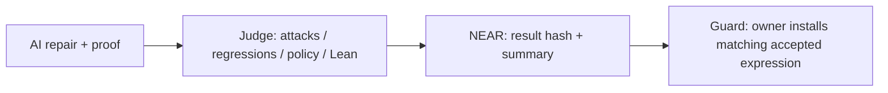

# Evaluate Fixseal

AI agents write fixes for code that holds money. Reviewing every change by hand does not scale.
Fixseal checks the patch and its proof against a fixed specification before a spending-policy replacement.
NEAR stores the result and gates replacement on a matching submitted accept record; anyone can rerun the judge.

**simulated environment, synthetic data** — spend results:

| Repair | First judge verdict | Final verdict | Attacks before → after / regressions |
| --- | --- | --- | --- |
| Devin (swe-2-high) | PROOF_REJECTED | accept | 12/12 → 0/12 · 16/16 |
| Codex (gpt-6.1-sol) | PROOF_REJECTED | accept | 12/12 → 0/12 · 16/16 |
| DeepSeek V4.1 Flash via NEAR AI Cloud¹ | accept | operator rejudge: accept | 12/12 → 0/12 · 16/16 |

[Try the 60-second saved-evidence inspection](README.md#60-second-inspection--do-x-see-y) · [Run the proof replay](JUDGES.md#first-five-minutes-offline-route) · [AI records and differing run conditions](README.md#real-ai-fixers-blind-run).



¹ NX1: 120-turn cap; no `done` call; operator rejudged the same copy. FX3 first proofs are reconstructed. These runs are not a model ranking. The contract trusts the submitter and does not run Lean; the exporter/interpreter and owner remain trusted. [Scope](ASSUMPTIONS.md). The current guard ran end to end on a local NEAR sandbox ([log](docs/demo-output-host-guard.txt)); testnet remains unconfirmed.

Start at the repository root with `scripts/judge-check.sh --stage a`: see A1/A2 pass for saved evidence integrity and A3 skip with networking disabled. Then run `scripts/judge-check.sh` on a prepared Rust/Lean host: see B1–B3/B5 and C1–C5 pass, and B4 skip for the separate sandbox demo. All examples use a **simulated environment, synthetic data**. Check both the verdict and verification status; a reproduced rejection can be `VERIFIED`. [Claim → check ID → prerequisites](README.md#full-evaluation--do-x-see-y), [timings and Docker](docs/judge-check.md), [background and independent status](README.md).

CI has **not yet run on GitHub**. First public execution-log URL: added after the first public CI run. The current guard ran end to end on a local NEAR sandbox with freshly built wasm ([log](docs/demo-output-host-guard.txt)); the historical FIX5 logs predate that guard.

## Prerequisites

| Tool / resource | Version / location | Required for |
| --- | --- | --- |
| Rust + Cargo | Tested with 1.99.1; edition 2024; rustfmt/clippy for checks | All Rust commands |
| Cargo dependency cache | Matching `judge/Cargo.lock`; also `agent-contract/Cargo.lock` for contract tests | Offline builds |
| Lean + Lake | Exactly 4.34.1; native binaries, no external Lean packages | Proofs and replay |
| Native C compiler | Installed host compiler | Lean executable |
| Bash | For `scripts/demo.sh` | Chain demo |
| near-sandbox | 2.11.0, preinstalled executable | Chain demo / sandbox tests |
| Contract wasm | `agent-contract/target/near/shade_contract_template.wasm` | Chain demo / sandbox tests |
| Python 3 | Standard library | Development public export checks |

A clone contains source and lockfiles, not toolchains, dependency caches, sandbox or built contract wasm. [SETUP.md](docs/SETUP.md) documents separate initial preparation and wasm generation. Do not run its network/install commands in an environment that forbids downloads. Have the operator provide the prerequisites instead. Node, Docker and a testnet account are unnecessary for the prepared offline route.

The judge directly uses `$HOME/.elan/toolchains/leanprover--lean4---v4.34.1/bin`. If installed elsewhere, set `FIXSEAL_LEAN_BIN` to that version's actual `bin` directory. For direct `lake` commands, also place it on PATH:

```sh
export FIXSEAL_LEAN_BIN="${FIXSEAL_LEAN_BIN:-$HOME/.elan/toolchains/leanprover--lean4---v4.34.1/bin}"
export PATH="$FIXSEAL_LEAN_BIN:$PATH"
```

## First five minutes: offline route

Time budgets below are estimates for a prepared machine. In one prepared macOS arm64 run, bundle generation took 7.073 seconds and replay took 7.786 seconds (**simulated environment, synthetic data**, warm dependencies, path-6). This is not a cold-build or CI timing; native compilation may take longer.

1. Generate the honest bundle (allow roughly 1–2 minutes with warm dependency caches):

   ```sh
   mkdir -p demo-artifacts
   cargo run --manifest-path judge/Cargo.toml --locked --offline -- bundle --lean lean after_honest > demo-artifacts/bundle.json
   ```

   Expect exit 0 and a JSON file. Its `report.judge_version` is `0.1.0/lean-path-7`, `report.verdict` is `accept`, `report.reason_codes` is `[]`, and `report.proof.verified` is `true`. Bundle export can also succeed for a rejected fix; export exit status alone does not mean acceptance.

2. Replay it (allow roughly another minute):

   ```sh
   cargo run --manifest-path judge/Cargo.toml --locked --offline -- verify demo-artifacts/bundle.json
   ```

   Expect `OK` hash/report checks, `OK Lean: lake build + axiom audit + forbidden syntax inspection`, `chain readback: not supplied`, `VERIFIED`, exit 0. This recomputes the input/result hashes and reruns the judge and kernel checks.

3. Try a dishonest proof (optional, roughly one minute):

   ```sh
   cargo run --manifest-path judge/Cargo.toml --locked --offline -- --lean lean after_cheat
   ```

   Expect JSON with verdict `reject`, reason `PROOF_CHEATED`, proof verified `false`, exit **1**. The honest implementation is unchanged, but its proof uses `sorry`. A successful standalone `lake build` does not enforce the judge's no-cheating policy.

## Spend subject (offline)

Spend Target expressions must use UInt64 and Bool operations; `target_forbidden_identifiers` and representation-access checks reject wider arithmetic, conversions such as `toNat` and scope/alias/syntax definitions with `POLICY_VIOLATION`, while Proof may use `toNat`. The trusted `TargetAudit.lean` also inspects the elaborated Target body, including type arguments and let bindings, for Nat/Int/BitVec/Fin constants and rejects them with `POLICY_VIOLATION` before execution. UInt64 literals are allowed; trusted core implementations are not recursively expanded.

The default subject remains path. Select spend explicitly for judging or bundle generation; replay reads the subject from the bundle and includes it in the input hash.

```sh
mkdir -p demo-artifacts
cargo run --manifest-path judge/Cargo.toml --locked --offline -- bundle --lean --subject spend lean after_honest > demo-artifacts/spend.json
cargo run --manifest-path judge/Cargo.toml --locked --offline -- verify demo-artifacts/spend.json
```

Expect `0.1.0/lean-spend-4`, `accept`, proof verified `true`, attacks 0/12 and regressions 16/16. The four other fixes reject as shown in the [spend table](README.md#agent-spending-limit-overflow); `after_cheat` passes attacks 0/12 and regressions 16/16 with UInt64/Bool operations, but its `sorry` proof reports `PROOF_CHEATED` alone. Saturation incorrectly accepts overflow when the limit is UInt64's maximum. All values are synthetic. The specification is a fixed review reference, not a record of completed human approval.

The spend report now also contains canonical `policy_expr`, its `policy_expr_sha256`, and `export_checked_inputs: 1028` (12 attacks, 16 regressions, 1,000 boundary triples). One Lean/interpreter disagreement rejects with `EXPORT_MISMATCH`. Replay re-exports and compares the expression/hash. The fixed exporter and shared Rust interpreter are trusted, outside the proof about Lean's `Target.authorize`; fixed-input correspondence is a check, not a proof. Contract record submitters are trusted, with no TEE. Anyone can rerun `fixseal-judge verify` independently.

## Replay the archived AI fixes (offline)

```sh
cargo test --manifest-path judge/Cargo.toml --locked --offline --test fixers
```

Expect three passing tests covering the four FX3 attempts and the NX1 final source, including bundle replay. FX3: first attempts report `PROOF_REJECTED`, second attempts `accept`, all with attacks 0/12 and regressions 16/16. NX1 obtained accept on its first shell judge submission, never called `done` within 120 turns and was rejudged by the operator; current replay uses spend-4. FX3 first proofs are reconstructions from recorded errors and edits; this is a replay, not a new blind experiment. See [archive provenance](examples/fixers/README.md).

## Local NEAR route

Allow roughly 1–3 minutes with warm caches; this is an estimate. Requires localhost bind/listen permissions, the prebuilt contract and sandbox listed above. An alternative binary location must be an absolute path in `NEAR_SANDBOX_BIN_PATH`.

```sh
scripts/demo.sh --check
scripts/demo.sh
```

Preflight: `Required executables and contract wasm found`; exit 0. It checks file presence only. Full run: `Sandbox started on loopback`, contract deployment and mock agent registration, then `submit_fix_proof → get_fix_proof → verify` for path then spend (five fixes each), ten `VERIFIED` results, and the [README final table](README.md#five-fixes-one-accepted) plus the spend table with ten total `matched` entries; exit 0. The operator's [FIX5 host record](docs/demo-output-host-fix5.txt) completed path-7/spend-3 on 2026-11-10: both Lean builds, ten matched chain readbacks/replays and demo exit 0. The operator separately reports 66 judge tests and 72 contract tests passing; the linked file contains the demo output rather than the full suite output.

The earlier [T008 host record](docs/demo-output-host-t008.txt) used path-7/spend-2 and remains historical evidence.

The contract records authorized agent claims; it does not verify proofs. Local attestation is mock. Logs and bundles are in `demo-artifacts/`; they do not overwrite the reference record.

The default demo now runs the guard after both subjects; `scripts/demo.sh --guard` runs guard alone. Rebuild wasm from the current source before running it. The guard checks accept/spend records, fixed spec, canonical expression/hash and allowlisted judge before replacement, and interprets the expression before transferring yoctoNEAR. Restricted function-call key setup and limits are in [guard.md](docs/guard.md). The guard ran end to end on a local NEAR sandbox ([log](docs/demo-output-host-guard.txt)); testnet remains pending. See [host results and checks](docs/t010-host-check.md). `scripts/testnet-guard.sh --check` is local only; `--execute` is for a separately authorized operator with existing accounts/keychain. [Evidence template](docs/testnet-evidence.md).

## Additional checks

Prepared offline environment, in order:

```sh
(cd lean && lake build && lake env lean SpecTests.lean)
(cd lean/targets/spend && lake build)
python3 scripts/check-spend-proof-leak.py --self-test
cargo fmt --manifest-path judge/Cargo.toml -- --check
cargo clippy --manifest-path judge/Cargo.toml --locked --offline --all-targets -- -D warnings
cargo test --manifest-path judge/Cargo.toml --locked --offline
cargo test --manifest-path agent-contract/Cargo.toml --locked --offline --lib
cargo test --manifest-path agent-contract/Cargo.toml --locked --offline --test guard_tests
cargo test --manifest-path agent-contract/Cargo.toml --locked --offline --test fix_proof_tests
cargo test --manifest-path agent-contract/Cargo.toml --locked --offline --test local_demo
```

Expect successful Lean builds, axiom audit using only `propext`, `Quot.sound`, `Classical.choice`, and passing Rust tests. The last command runs the summary format test; the chain demo is opt-in via `scripts/demo.sh`. Allow several minutes for the test suite, longer with a cold contract dependency build.

For all contract sandbox tests on a capable host, first set `NEAR_SANDBOX_BIN_PATH` to an existing absolute executable path (to prevent runtime downloading), then run:

```sh
cargo test --manifest-path agent-contract/Cargo.toml --locked --offline --no-fail-fast
```

## Failures and interpretation

| Symptom | Meaning / action |
| --- | --- |
| `cargo` missing / edition unsupported | Provide Rust/Cargo 1.99.1 on PATH; match `cargo` and `rustc`. |
| `--offline` cannot find a package | Locked dependencies are not cached; have the operator prepare them. Do not remove `--offline` in a restricted evaluation. |
| `PROOF_REJECTED` / missing Lean | Check the actual Lean 4.34.1 binaries and `FIXSEAL_LEAN_BIN`; the judge will not download a toolchain. A reproducible rejection can still show `VERIFIED`. |
| `PROOF_TIMEOUT` | A subprocess exceeded 120 seconds by default. Investigate resources; a positive integer `FIXSEAL_LEAN_TIMEOUT_SECS` can raise the limit. Regenerate and replay with the same setting. |
| `Missing prebuilt ...wasm` / missing sandbox | Supply matching wasm and sandbox using [SETUP.md](docs/SETUP.md). `--check` exits 2; it never builds or downloads them. |
| `Operation not permitted` while binding | This coding sandbox blocks localhost bind. Offline replay still works. Run chain integration in the operator's host shell; do not report a chain pass. |
| `MISMATCH` / `VERIFICATION FAILED` | Input, report, version, result hash or readback differs. Do not edit expected hashes to force a pass. Old path-5 bundles require path-5; generate new path-7 / spend-4 bundles for current code. |
| `VERIFIED` with verdict `reject` | The rejection was reproduced. Inspect verdict, reasons and proof status; verification is not acceptance. |

See [ASSUMPTIONS.md](ASSUMPTIONS.md) for the precise proof scope, trusted components and offline readback limitations. [AGENTS.md](AGENTS.md) describes candidate creation and protected inputs.
