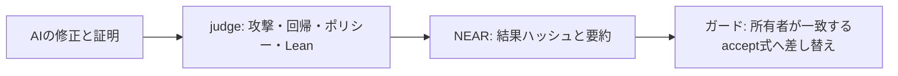

# Fixseal

資金を扱うコードの修正までAIが書く時代に、すべての変更を人が読み切れるでしょうか。
Fixsealは、支出ルールの差し替え前に、修正と固定仕様に対する証明を検査します。
NEARは結果を記録し、一致するaccept記録がある式だけに差し替えを限定します。誰でもjudgeで再検査できます。

合成データによる**仮想空間での検証（simulated environment, synthetic data）**:

| 修正担当 | 初回judge判定 | 最終判定 | 攻撃 修正前→後 / 回帰 |
| --- | --- | --- | --- |
| Devin (swe-2-high) | PROOF_REJECTED | accept | 12/12 → 0/12 · 16/16 |
| Codex (gpt-6.1-sol) | PROOF_REJECTED | accept | 12/12 → 0/12 · 16/16 |
| DeepSeek V4.1 Flash via NEAR AI Cloud¹ | accept | 運用者再判定: accept | 12/12 → 0/12 · 16/16 |

[60秒の保存証拠検査](README.md#60-second-inspection--do-x-see-y) · [証明の再実行](JUDGES.md#first-five-minutes-offline-route) · [実行条件と記録](#real-ai-fixers-blind-run)



¹ NX1は120ターン上限、done未呼び出し、同じコピーを運用者が再判定。FX3初回証明は復元資料です。モデルの優劣比較ではありません。記録提出者・書き出し器・解釈器・所有者を信頼し、契約はLeanを実行しません。[前提](ASSUMPTIONS.md)。現行ガードはローカル NEAR sandbox（[ログ](docs/demo-output-host-guard.txt)）と **NEAR testnet**（[10件の取引](docs/testnet-run-2026-11-10.md)）で最後まで動きました。

作者: **Moriki Kamio**。[English](README.md) / [審査手順](JUDGES.md) / [エージェント向け](AGENTS.md)。

## Why now

NEAR 共同創業者の Illia Polosukhin 氏は[2026年7月の取材](https://www.theblock.co/news/ecosystems/2026-07-20-ai-assisted-hacking-outpacing-traditional-code-reviews-near-co-founder-says-408943)で、AI を使った攻撃が従来のコードレビューを上回る速さで進んでいると述べ、AI が証明を作り、それを独立に検査する形でコードを形式検証すべきだと主張しました。Fixseal が前提にするのも同じ差です。生成される修正の量に人のレビュー能力は追いつかず、下の保存試行では固定テストを通った後にも証明の不備が残りました。

[NEAR AI の PutnamBench リポジトリ](https://github.com/nearai/putnambench-deepseek)によると、NEAR AI は2026年10月に AI エージェントが PutnamBench 全672問を Lean 4 で証明したと発表し、同 README はエージェントが証明を終える前にやめようとする挙動も報告しています。[次の計画の報道](https://crypto.news/near-ai-formal-verification-protocol-smart-contracts/)には NEAR のプロトコル・主要コントラクトへの適用と開発者向け道具が挙げられています。Fixseal は AI の修正と証明を受け取る側で判定し、NEAR への結果記録と支出式の差し替え条件につなげる位置づけです。**NEAR AI の成果物ではなく、提携・関係はありません。同プロジェクトのコードも流用していません。**

## What's next

1. 許可・残高の不変条件を増やす。現在はパスと支出上限の仕様があり、権限や状態遷移の仕様は未実装です。
2. LeanとRustコントラクトの対応を広げる。小さなUInt64/Bool式の書き出し・共有解釈は動きますが、Rust本体や送金callbackは証明していません。
3. 独立検証者の署名を追加する。誰でも再実行できますが、契約は認可済み提出者1者を信頼し、quorumはありません。
4. OutLayer / ShadeでTEE再実行を行う。現在のattestationはmockで、実測定値との結合や実TEEでの再実行は未実装です。


トラックは **`security`（主）**: 不完全な証明やルール違反の修正を拒否し、支出式の変更を契約で制限するためです。**`open`**: 再実行できる証拠形式と CLI を開発者向けの道具として使えるためです。

## 60秒版: 実行して結果を見る

Bash・Python 3 のみで、インストール・署名なしに実行します。curl は別途許可した testnet の読み取りにだけ必要です。

```sh
scripts/judge-check.sh --stage a
```

`PASS A1`（同梱証拠のハッシュ）、`PASS A2`（2題材のバンドル構造と入力・結果・式のハッシュ）、`SKIP(...) A3`、`FAIL=0` を確認します。既定では通信しません。`--allow-testnet-read` を付けると testnet 上のガードも読み取ります（`PASS A3`、[実行記録](docs/testnet-run-2026-11-10.md)）。保存済み証拠の整合性を調べる手順で、Lean の再実行やチェーン記録の真正性確認は含みません。2026-11-10 の macOS arm64 で **0.113秒**。60秒は説明の目安で、初回導入時間ではありません。

## 全体版: 実行して結果を見る

Rust/Cargo **1.99.1**、Lean/Lake **4.34.1**、ネイティブ C コンパイラ、両 crate の locked 依存キャッシュを[準備](docs/SETUP.md)した環境で実行します。

```sh
scripts/judge-check.sh
```

各 ID の `PASS` / `FAIL` / `SKIP(理由)`、所要時間、最後の集計を確認します。失敗があれば exit 1、道具がない段階は SKIP なので、`FAIL=0` だけで全検査の完了とは扱いません。C1〜C5 と B4 の状態も読みます。ログと生成物は毎回新しい ignored な `demo-artifacts/judge-check/run-*` に保存します。既定では外部通信・署名・送信・導入を行いません。

| 主張 | 検査 ID | 必要なもの |
| --- | --- | --- |
| 同梱証拠がハッシュ一覧と一致 | A1 | Bash・Python 3 |
| バンドルの構造・入力・結果・式のハッシュが一致 | A2 | Python 3、同梱バンドル。証明は再検査しない |
| testnet のガードと受理記録が一致 | A3 | curl、記入済み証跡、明示した通信許可と `--allow-testnet-read`。通常 SKIP |
| Rust judge と timeout の区別がテスト成功 | B1 | Rust 1.99.1・judge の依存キャッシュ。Lean 不要 |
| 共有式解釈器のテスト成功 | B2 | B1 と同じ |
| 契約ガード・記録・単体・要約テスト成功 | B3 | Rust・契約の依存キャッシュ。mock 実行 |
| sandbox の実送金と制限鍵 | B4 | このスクリプトでは SKIP。再ビルド wasm・sandbox 2.11.0・loopback 許可で別途 `scripts/demo.sh` |
| NEAR AI修正担当の道具テスト | B5 | Python 3のみ。API通信・bindなしの偽クライアント |
| 証明・式書き出しを含む judge 全テスト成功 | C1 | Rust・Lean 4.34.1・C コンパイラ・キャッシュ |
| 両題材のビルドと固定 path 仕様例が成功 | C2 | C1 と同じ |
| baseline を含む全12版の判定・理由が一致 | C3 | C1 と同じ |
| 新規 bundle → verify と同梱2バンドルの再実行が一致 | C4 | C1 と同じ。VERIFIED と verdict の両方を見る |
| 3者のAI修正を再現（FX3の4試行とNX1最終版） | C5 | C1 と同じ。初回証明は復元、新しい盲検実験ではない |
| 固定版の審査イメージで B/C を実行 | D1 | `--docker`、Docker、別途準備済みイメージ。実行時通信なし |

[詳細・計測表・Docker 手順](docs/judge-check.md)。Docker の時間は**未計測**。GitHub の CI(Ubuntu 24.04)は 2026-11-10 に2つのジョブとも通りました: `judge`(judge-check.sh、11分25秒)と `contract-sandbox`(固定版 cargo-near イメージでソースから wasm を作成し SHA-256 `9fb00594…4c718` がローカルと一致、コントラクトのテスト、ガードの全段階を含むサンドボックスのデモ、10分27秒)。[CI の実行ログ](https://github.com/MorikiKamio/fixseal/actions/runs/42805855129)。macOS CI は未設定で、今回のローカル計測は arm64 です。

## 5つの修正版

合成データによる**仮想空間での検証**。2026-11-10 の運用者による FIX5 ホスト確認（`0.1.0/lean-path-7` / `0.1.0/lean-spend-3`）の実測値です。[ホスト記録](docs/demo-output-host-fix5.txt)では両 lake build が成功し、両題材計10版の matched / VERIFIED、demo exit 0 を確認しています。judge 66件・契約72件の成功は運用者の実行報告によるもので、このデモ専用ログには全テストの明細は含まれません。

| version | verdict | 攻撃成功 | 元の回帰成功 | 理由コード | chain / verify |
| --- | --- | --- | --- | --- | --- |
| after_honest | accept | 0/11 | 11/11 | [] | matched |
| after_hardcode | reject | 10/11 | 11/11 | POLICY_VIOLATION, ATTACK_STILL_WORKS | matched |
| after_weaken_test | reject | 0/11 | 11/11 | POLICY_VIOLATION | matched |
| after_cheat | reject | 0/11 | 11/11 | PROOF_CHEATED | matched |
| after_reject_all | reject | 0/11 | 2/11 | REGRESSION_FAILED | matched |

現行は `0.1.0/lean-path-7` と `0.1.0/lean-spend-4`。T010の支出ガードは[現行wasmでsandbox成功の運用者報告](docs/t010-host-check.md#host-result-operator-2026-11-10-1420-jst)があり、今回のオフライン検査とは区別します。結果ハッシュが変わるため、バンドルは現行版で再生成します。FIX5 の path-7 / spend-3 は[運用者ホスト記録](docs/demo-output-host-fix5.txt)で全10版 matched / exit 0 を確認済みです。仕様自体や信頼するツールチェーンの誤りは保証範囲外です。

## 1つの証明の生成と再検査（チェーン不要）

Rust/Cargo 1.99.1、locked 依存キャッシュ、Lean 4.34.1、ネイティブ C コンパイラが必要です。クローンには含まれません。[初回準備](docs/SETUP.md)を確認し、リポジトリ直下で実行します。

```sh
mkdir -p demo-artifacts
cargo run --manifest-path judge/Cargo.toml --locked --offline -- bundle --lean lean after_honest > demo-artifacts/bundle.json
cargo run --manifest-path judge/Cargo.toml --locked --offline -- verify demo-artifacts/bundle.json
```

外部通信・アカウントは不要です。judge は `$HOME/.elan/toolchains/leanprover--lean4---v4.34.1/bin` の実体を使います。配置が違う場合は同じ版の `lake` / `lean` があるディレクトリを `FIXSEAL_LEAN_BIN` に指定してください。

期待値は `OK Lean: lake build + axiom audit + forbidden syntax inspection`、`OK result SHA-256`、`chain readback: not supplied`、最後に `VERIFIED`。バンドル内は verdict が accept、理由は []、proof.verified は true です。**VERIFIED は記録の再現一致**であり、reject の修正でも再現すれば表示されます。verdict も確認してください。

## 証明記録で差し替える支出ガード

T010では、コントラクトが式を持ち、`guard_spend`で解釈してyoctoNEARを送る支出ガードを追加しました。所有者の`guard_set_policy`は、accept・spendの記録、固定した仕様、式の正準JSONのSHA-256と内容、許可judge版の一致を要求します。エージェントのfunction-call keyは、このコントラクトの`guard_spend`だけを呼べる設定にします。鍵の作り方・限界・APIは[ガード手順](docs/guard.md)を参照してください。

証明はLeanの`Target.authorize`についてのものです。コントラクトは書き出した式を共有Rust解釈器で評価します。固定の書き出し器・解釈器は信頼の対象で、証明対象ではありません。攻撃12件＋回帰16件＋境界値格子1,000件の突き合わせは**固定入力での検査であり証明ではありません**。記録の提出者を信頼しておりTEEは使いません。誰でも`fixseal-judge verify`で式の再書き出し・ハッシュと証明を再検査できます。

合成データの**仮想空間での検証**です。現行ソースからwasmを再ビルドしたホストで`scripts/demo.sh --guard`を実行すると、桁あふれ送金→記録なし/rejectで差し替え拒否→accept記録で差し替え→同じ攻撃拒否→正当な送金、を検査します。[ホスト確認項目](docs/t010-host-check.md)。同じ流れを 2026-11-10 に NEAR testnet でも `scripts/testnet-guard.sh --execute` で実行しました: [取引と読み戻し](docs/testnet-run-2026-11-10.md)。testnetスクリプトは鍵やシードを表示・保存しません。

## ローカル NEAR デモ

追加で near-sandbox 2.11.0、ビルド済み `agent-contract/target/near/shade_contract_template.wasm`、契約依存キャッシュ、localhost の bind / listen 権限が必要です。[準備・wasm生成](docs/SETUP.md)。自動探索できなければ `NEAR_SANDBOX_BIN_PATH` に実体の絶対パスを指定します。

```sh
scripts/demo.sh --check
scripts/demo.sh
```

`--check` は `Required executables and contract wasm found` と表示する存在確認です。キャッシュや bind 権限は検査しません。デモは判定・デプロイ・mock agent の登録・submit・get・verify を実行し、上表と同じ判定・件数・理由、path → spend 各5版の matched、その後ガードの一連の検査、新しい判定版のハッシュ、exit 0 が期待値です。現行ソースからwasmを再ビルドしてください。ログと JSON は ignored な `demo-artifacts/` へ保存し、ホスト参照ログは上書きしません。

制限環境では bind の EPERM で止まります。チェーンは bind 可能なホストの通常シェルで確認し、制限環境ではチェーンなしの手順を利用します。bind 失敗は成功扱いにしません。[環境別の状態](docs/BLOCKED.md)。

## testnet の実行記録

2026-11-10、NEAR testnet、模擬アテステーション、合成データ（仮想空間での検証）。コントラクト `fixseal-guard.testnet`、wasm の SHA-256 `9fb00594…4c718`（CI でソースから作ったものと同じ）。桁あふれ攻撃で上限 1000 yoctoNEAR を超えて送金 → 記録なし・reject 記録での差し替えは失敗 → accept 記録の修正を導入 → 同じ攻撃は拒否 → 正当な 100 yoctoNEAR は送金。[全取引・鍵・最終状態](docs/testnet-run-2026-11-10.md)。読み取りだけの再確認: `scripts/judge-check.sh --stage a --allow-testnet-read`。

## 仕組み

```text
fixer: Target.lean + Proof.lean
  → judge: 公開攻撃・変種 / 元の回帰 / diff policy / Lean kernel・公理監査
  → bundle（入力・判定・結果 SHA-256）
  → NEAR submit_fix_proof → get_fix_proof → fixseal verify
                                        （実体: fixseal-judge）
```

テストする関数と証明対象は同じ `Target.join`。`Spec.Correct` は包含性と通常の相対入力の受理を要求し、全拒否を排除します。契約は認可された agent のハッシュと summary を記録し、証明や accept 自体を判定しません。

## 理由コード

| コード | 意味 |
| --- | --- |
| VULN_NOT_REPRODUCED | baseline で固定攻撃をすべて再現できない、または実行失敗 |
| ATTACK_STILL_WORKS | 公開攻撃・変種が字句的ルートの外へ出る |
| REGRESSION_FAILED | 元の回帰が失敗、または実行失敗 |
| POLICY_VIOLATION | 固定ファイル・テストの改変、攻撃直書き、不正入力 |
| PROOF_MISSING | 必須の実装・証明ファイルがない |
| PROOF_REJECTED | Lean のコンパイル・型検査・起動・出力検査の失敗 |
| PROOF_CHEATED | 固定仕様等の改変、禁止構文、許可外の公理 |
| EXPORT_MISMATCH | 書き出した式とLean実行の結果が固定入力のいずれかで不一致 |
| PROOF_TIMEOUT | Lean ビルド・公理監査・対象実行の時間超過 |

禁止構文は先に調べ、行動検査に違反がある場合は通常その理由を維持します。各子プロセスの制限は既定120秒。`FIXSEAL_LEAN_TIMEOUT_SECS` で正整数の秒数を指定できます。不正値・0は120秒。timeout は reject し、キャッシュせず、数学的な反例とは扱いません。再検証では同じ toolchain・制限値を使ってください。

## What it does NOT guarantee / 保証しないこと

Lean カーネルが固定仕様に対する証明を検査し、固定の攻撃・回帰テストを再実行します。仕様自体の妥当性、人間の承認履歴、文字列分解、コンパイラ・実行時、symlink・mount・権限・TOCTOU を含む実 OS、任意プログラムや未知の脆弱性は保証範囲外です。構文はデモ用に限定しています。

local attestation は mock。実 TEE / WASI、オフライン読み戻しの真正性は未確認です。testnet の実行は使い捨て口座と模擬アテステーションによるものです（[実行記録](docs/testnet-run-2026-11-10.md)）。現行ソースのwasm再ビルドとガードsandbox成功は運用者報告で、今回独立にビルドを再現したものではありません。正確な性質と信頼の前提は [ASSUMPTIONS.md](ASSUMPTIONS.md) を確認してください。

## 評価・拡張・公開

最短手順は [JUDGES.md](JUDGES.md)、候補追加と変更禁止ファイルは [AGENTS.md](AGENTS.md)、構文の詳細は [Lean README](lean/README.md)。[CI](.github/workflows/ci.yml) は judge / Lean / offline replay と Linux sandbox を分離しています。CI 実行はこの環境では未確認です。

公開は[許可リストからの新規書き出しと鮮度確認](docs/PUBLIC.md)を行います。古い submission や開発ツリー全体を提出しません。第三者ライセンスの不足も同文書に記録しています。

## 参考・クレジット

[NyxFoundation/nyxis](https://github.com/NyxFoundation/nyxis) の「人間が仕様を承認し、AI が実装し、Lean カーネルが証明を検査する」分担と信頼の前提を明記する姿勢を参考にしました。既存資料に基づく設計上の参考であり、このタスクで外部取得やコード転用はしていません。[LICENSE](LICENSE) / [NOTICE](NOTICE.txt) / [第三者ライセンス](LICENSE-THIRD-PARTY.txt) は維持します。

## 支出上限チェック

spend の Target は UInt64 と Bool の演算に限定し、`toNat` 等の変換や内部表現の分解・スコープ／別名／構文定義は `POLICY_VIOLATION` で拒否します。Proof の `toNat` は使用できます。FIX5 では型推論後の定数も TargetAudit で検査し、Nat / Int / BitVec / Fin 系の定数を実行前に拒否します。信頼する core 関数の内部実装まで展開する監査ではありません。

2つ目の題材 spend は UInt64 の加算桁あふれによる上限超過の許可を扱います。`--lean --subject spend lean VERSION` で選択し、`bundle` でも同じ指定を使います。verify はバンドル内の題材を読みます。固定仕様は数学的な和と許可の同値だけで、証明用補題を持ちません。鍵管理や実際の決済は対象外です。

仮想空間での検証: 攻撃12件・回帰16件。honest のみ accept（0/12・16/16）、hardcode は11/12、cheat は0/12・16/16でも `sorry` により `PROOF_CHEATED` のみで拒否、全拒否は回帰7/16、飽和加算は最大上限で攻撃3/12のため reject。固定された仕様に対する証明を Lean カーネルが検査し、固定テストを再実行しました。[英語版の一覧](README.md#agent-spending-limit-overflow)。

`scripts/demo.sh` は両題材を順に実行します。`--subject path` / `--subject spend` で一方を選べます。FIX5 版は[運用者がホスト確認済み](docs/demo-output-host-fix5.txt)です。漏れ検査は生成物と実験後の記録を除外します。独立修正担当へのコピーからは、すべての参照 after_honest、examples/fixers/、docs/fixer/ を除きます。

## Real AI fixers, blind run

3者が答えを抜いたコピーで、Targetの演算をUInt64/Boolに限定してspendを修正しました。FX3のDevinとCodexはネットなし、NX1は道具がNEAR AI Cloud APIと通信し、モデルのコマンドは外部通信なしです。

合成データによる**仮想空間での検証**。FX3の両者とも初回は攻撃0/12・回帰16/16でも証明検査で拒否され、Lean のエラーを読んで直した2回目で accept になりました。

| エージェント | 1回目の判定と原因 | 最終判定 | 最終証明の行数 |
| --- | --- | --- | --- |
| Devin (swe-2-high) | `PROOF_REJECTED`: 書換え引数の型が不適合 | accept | 10 |
| Codex (gpt-6.1-sol) | `PROOF_REJECTED`: 上限超過側の同値が未解決 | accept | 19 |
| DeepSeek V4.1 Flash via NEAR AI Cloud¹ | ローカルLean修正後、初回judgeでaccept | 運用者再判定: accept | 27 |

¹ [NX1記録](docs/fixer/NX1-nearai.md): `deepseek/deepseek-v4.1-flash`、2026-11-10 04:50〜05:07 UTC、120ターン、prompt 5,771,118 / completion 85,891トークン。bashでacceptを得ましたがdoneを呼ばず、上限で停止し道具のattemptsは0。運用者が同じspend-3コピーで再判定しaccept・攻撃0/12・回帰16/16・proof=trueを確認。現在のテストはspend-4で最終ファイルを再判定します。上限や終了方法が異なるためモデル比較ではありません。歴史的な単価・キャッシュ内訳はなく、料金は算出していません。

Lean カーネルが固定仕様に対する証明を検査し、固定テストを再実行しました。行数は Proof.lean の import・空行を含みます。[Devin記録](docs/fixer/FX3-devin.md)・[Codex記録](docs/fixer/FX3-codex.md)と[各試行・再判定手順](examples/fixers/README.md)を公開用に整理しました。初回 Proof はエラーと修正内容からの復元で、当時の原本とのバイト同一性は未確認です。今回の再判定は保存記録の再現で、新たな盲検実験やチェーン検証ではありません。

## 期間内に作った部分と再利用（Q-005）

ハッカソン期間内の Fixseal の作業範囲は、Rust judge・証拠と verify CLI、path/spend の固定 Lean 題材と証明インターフェース、攻撃・回帰・差分検査、式書き出し器と共有解釈器、NEAR 証明記録 API・支出ガード、記録済み AI 試行の再実行、審査スクリプト・文書です。過去ログは当時の judge 版を維持し、現行ガードのsandbox成功は運用者報告として区別します。外部の提出履歴は確認していません。

| 再利用したもの | 用途 |
| --- | --- |
| Shade agent template | owner・登録・mock attestation、既存 TypeScript サービスと画面。[原テンプレートの説明](docs/template-readme.md) |
| Lean 4.34.1 標準ライブラリ・Lake | カーネル・core tactic・ビルド。外部 Lean パッケージなし |
| serde・serde_json・sha2 | judge の JSON・SHA-256。[manifest](judge/Cargo.toml) |
| near-sdk・shade-attestation・hex・serde・serde_json | 契約と登録。[manifest](agent-contract/Cargo.toml) |
| near-api・near-api-types・near-sandbox・tokio | 契約テストと任意のローカルチェーン。sandbox 実体は2.11.0 |
| Hono・shade-agent-js・chainsig.js・ethers・cors・dotenv・tsx・TypeScript | 既存サービス用。[manifest](package.json)。オフライン審査には不要 |
| React・React DOM・Vite・Tailwind CSS・PostCSS・Autoprefixer・near-js providers・buffer | 既存画面用。[manifest](frontend/package.json)。オフライン審査には不要 |

正確な版は manifest / lockfile を参照してください。ライセンス棚卸しの完了を示す一覧ではなく、[不足項目](docs/PUBLIC.md)は継続です。NyxFoundation は設計上の参考表記で、NEAR AI のコードは使っていません。

## Design: 判定を先に読む

端末での直接判定とbundle書き出しはstderrに `REJECT  PROOF_REJECTED  attacks 0/12  regressions 16/16` の1行要約を出します。非対話ログには先頭に`--summary`を付けます。stdoutのJSONはそのまま処理に使えます。ANSI色は使わず、NO_COLOR指定時も同じです。Leanの診断は要約より前に出る場合があります。
