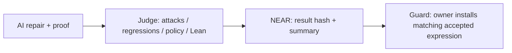

# Fixseal

AI agents write fixes for code that holds money. Reviewing every change by hand does not scale.
Fixseal checks the patch and its proof against a fixed specification before a spending-policy replacement.
NEAR stores the result and gates replacement on a matching submitted accept record; anyone can rerun the judge.

**simulated environment, synthetic data** — spend results:

| Repair | First judge verdict | Final verdict | Attacks before → after / regressions |
| --- | --- | --- | --- |
| Devin (swe-2-high) | PROOF_REJECTED | accept | 12/12 → 0/12 · 16/16 |
| Codex (gpt-6.1-sol) | PROOF_REJECTED | accept | 12/12 → 0/12 · 16/16 |
| DeepSeek V4.1 Flash via NEAR AI Cloud¹ | accept | operator rejudge: accept | 12/12 → 0/12 · 16/16 |

[Try the 60-second saved-evidence inspection](README.md#60-second-inspection--do-x-see-y) · [Run the proof replay](JUDGES.md#first-five-minutes-offline-route) · [AI records and differing run conditions](README.md#real-ai-fixers-blind-run).



¹ NX1: 120-turn cap; no `done` call; operator rejudged the same copy. FX3 first proofs are reconstructed. These runs are not a model ranking. The contract trusts the submitter and does not run Lean; the exporter/interpreter and owner remain trusted. [Scope](ASSUMPTIONS.md). The current guard ran end to end on a local NEAR sandbox ([log](docs/demo-output-host-guard.txt)) and on **NEAR testnet** ([10 transactions](docs/testnet-run-2026-11-10.md)).

Author: **Moriki Kamio**. [Japanese](README.ja.md) · [Evaluation details](JUDGES.md) · [Agent instructions](AGENTS.md).

## Why now

In a [July 2026 interview](https://www.theblock.co/news/ecosystems/2026-07-20-ai-assisted-hacking-outpacing-traditional-code-reviews-near-co-founder-says-408943), NEAR co-founder Illia Polosukhin said AI-assisted attacks are outpacing traditional code review and argued that code should be formally verified, with AI producing proofs that are then checked independently. Our design premise is the same gap: human review capacity will not grow with every generated patch, and the archived runs below show that passing tests still leaves proof work to check.

According to the [NEAR AI PutnamBench repository](https://github.com/nearai/putnambench-deepseek), NEAR AI reported in October 2026 that AI agents proved all 672 PutnamBench problems in Lean 4; its README also describes agents trying to stop before finishing proofs. [The reported next steps](https://crypto.news/near-ai-formal-verification-protocol-smart-contracts/) include applying formal verification to NEAR's protocol and core contracts and providing developer tools. Fixseal explores the receiving side: deciding whether to accept an AI patch and its proof, recording the result on NEAR, and requiring an accepted proof record for a spending-policy replacement. **Fixseal is independent of, unaffiliated with, and not a product of NEAR AI; no code from that project is reused.**

## What's next

1. Add permission and balance invariants: path containment and a spending cap exist; authorization/state specifications do not yet.
2. Extend the Lean-to-contract correspondence: a small UInt64/Bool expression exporter and shared interpreter work today; the Rust contract body and payment callbacks are not proved.
3. Add independent verifier signatures: anyone can replay a bundle today; the contract still trusts one authorized submitter and has no quorum.
4. Reexecute the judge in a TEE using OutLayer / Shade: current attestation is mock; measurement binding and real attested execution are unimplemented.

Tracks: **`security` (primary)**, because the judge rejects incomplete or policy-violating repairs and the contract gates spending-policy changes. **`open`**, because the replayable evidence format and CLI also serve as general developer tools.

## 60-second inspection — do X, see Y

Only Bash and Python 3 are required; curl is optional for a separately authorized read-only testnet check. Nothing is installed or signed. From the repository root:

```sh
scripts/judge-check.sh --stage a
```

See `PASS A1` for the packaged evidence hashes and `PASS A2` for two bundles' structure and input/result/expression hashes. Expect `SKIP(...) A3` and `FAIL=0`: network access is disabled by default. Add `--allow-testnet-read` to also read the live testnet guard (`PASS A3`; [run](docs/testnet-run-2026-11-10.md)). This inspects saved evidence; it does **not** rerun Lean or authenticate a chain record. Local warm-cache measurement: **0.113 seconds** on macOS arm64 (2026-11-10); 60 seconds is a presentation budget, not an installation estimate.

## Full evaluation — do X, see Y

With Rust/Cargo **1.99.1**, Lean/Lake **4.34.1**, a native C compiler and both crates' locked dependency caches already available ([setup](docs/SETUP.md)):

```sh
scripts/judge-check.sh
```

See one `PASS` / `FAIL` / `SKIP(reason)` line per ID, durations and a final count. A failure makes the command exit 1; missing toolchains produce explicit skips, so `FAIL=0` alone does not establish full evaluation. Inspect C1–C5 and B4 separately. Logs and generated bundles go to a new ignored `demo-artifacts/judge-check/run-*` directory. No signing, transactions, package installation or external network access occurs by default.

| Claim | Check ID | Required resources |
| --- | --- | --- |
| Packaged evidence bytes match the manifest | A1 | Bash, Python 3; no toolchains |
| Bundle structure and input/report/expression hashes agree | A2 | Python 3; saved bundles; no proof replay |
| Live guard and accepted record agree | A3 | curl, populated testnet evidence, explicit `--allow-testnet-read` network permission; otherwise SKIP |
| Rust judge behavior and timeout classification pass | B1 | Rust 1.99.1, locked judge cache; no Lean |
| Shared expression interpreter passes its tests | B2 | Same as B1 |
| Contract guard/record/unit/summary tests pass | B3 | Rust and locked contract cache; mock execution |
| Real sandbox payments and restricted keys | B4 | SKIP in this script; separately run `scripts/demo.sh` with rebuilt wasm, sandbox 2.11.0 and loopback permission |
| NEAR AI fixer tool tests | B5 | Python 3 only; fake API, no sockets or model run |
| Complete judge suite passes, including proof/export tests | C1 | Rust, Lean 4.34.1, native compiler, caches |
| Both subjects build and fixed path spec examples pass | C2 | Same as C1 |
| All 12 versions (including both baselines) retain their verdict/reasons | C3 | Same as C1 |
| Fresh bundle → verify and both packaged bundles replay | C4 | Same as C1; expect `VERIFIED` and inspect verdict |
| Three AI fixers: four FX3 attempts plus NX1 final replay | C5 | Same as C1; reconstructed first proofs, not a new blind run |
| B/C execute in the pinned review image | D1 | `--docker`, Docker, separately prebuilt image; runtime network disabled |

Timing details, Docker provisioning and skip semantics: [judge-check guide](docs/judge-check.md). Docker build/runtime timings are **unmeasured**. CI on GitHub (Ubuntu 24.04) passed both jobs on 2026-11-10: `judge` (judge-check.sh, 11m25s) and `contract-sandbox` (wasm built from source in the pinned cargo-near image, SHA-256 `9fb00594…4c718`, matching the local build; contract tests; the full sandbox demo including all guard steps, 10m27s). [CI run](https://github.com/MorikiKamio/fixseal/actions/runs/42805855129). A macOS CI job is not configured; the local measurements use arm64.

## Five fixes, one accepted

Synthetic path traversal demo — **simulated environment, synthetic data**. Measurements come from the operator's **2026-11-10 FIX5 host run, judges `0.1.0/lean-path-7` / `0.1.0/lean-spend-3`**, [recorded here](docs/demo-output-host-fix5.txt): demo exit 0, all ten path/spend chain readbacks and replays matched.

| Fix | Verdict | Attacks working | Original regressions passed | Reason codes | Chain / verify |
| --- | --- | --- | --- | --- | --- |
| `after_honest` | accept | 0/11 | 11/11 | `[]` | matched |
| `after_hardcode` | reject | 10/11 | 11/11 | `POLICY_VIOLATION`, `ATTACK_STILL_WORKS` | matched |
| `after_weaken_test` | reject | 0/11 | 11/11 | `POLICY_VIOLATION` | matched |
| `after_cheat` | reject | 0/11 | 11/11 | `PROOF_CHEATED` | matched |
| `after_reject_all` | reject | 0/11 | 2/11 | `REGRESSION_FAILED` | matched |

The current judges are **`0.1.0/lean-path-7`** and **`0.1.0/lean-spend-4`**. T010 adds expression export/comparison and the spending guard; the guard has run end to end on a local NEAR sandbox with freshly built wasm ([log](docs/demo-output-host-guard.txt)). They retain subprocess time limits and accept general core proof tactics. The operator confirmed the earlier path-7/spend-3 combination in the [FIX5 host run](docs/demo-output-host-fix5.txt): both Lean builds and all ten chain readbacks/replays completed successfully. The operator also reported 66 judge tests and 72 contract tests passing; those suite totals are supplied run metadata, not printed in the demo-only log. The earlier [T008 run](docs/demo-output-host-t008.txt) used spend-2. The Lean kernel checks a proof against a fixed specification; mistakes in that specification or trusted toolchain remain outside that result.

## Generate and replay one proof: no chain, no account

From the repository root, with **Rust/Cargo 1.99.1**, cached locked dependencies, **Lean 4.34.1** and a native C compiler already installed:

```sh
mkdir -p demo-artifacts
cargo run --manifest-path judge/Cargo.toml --locked --offline -- bundle --lean lean after_honest > demo-artifacts/bundle.json
cargo run --manifest-path judge/Cargo.toml --locked --offline -- verify demo-artifacts/bundle.json
```

No downloads or network access occur in these three commands. A fresh clone does not contain toolchains or dependency caches: see [setup](docs/SETUP.md) and [JUDGES.md](JUDGES.md) first if they are missing. The judge uses the real binaries in `$HOME/.elan/toolchains/leanprover--lean4---v4.34.1/bin`; for another installation, set `FIXSEAL_LEAN_BIN` to the directory containing that version's `lake` and `lean`.

Expected verification output includes:

```text
OK replayed verdict
OK Lean: lake build + axiom audit + forbidden syntax inspection
OK Lean proof status
OK complete replayed report (version, reasons, checks, spec)
OK result SHA-256
chain readback: not supplied
VERIFIED
```

The bundle's `report.verdict` is `accept`, `report.reason_codes` is `[]`, and `report.proof.verified` is `true`. `VERIFIED` means the recorded result was reproduced: a rejected fix can also produce `VERIFIED`. Check the verdict as well. See [bundle format and CLI](judge/README.md).

## Agent spending limit overflow

The second subject checks `authorize (limit spent amount : UInt64) : Bool`. Spend Target expressions are restricted to UInt64 and Bool operations: `target_forbidden_identifiers` rejects conversions such as `toNat` (including qualified/dot forms), other numeric representations and scope/alias/syntax definitions with `POLICY_VIOLATION`; representation unpacking is also rejected, while Proof may freely use `toNat`. The trusted `TargetAudit.lean` also inspects the elaborated Target body, including type arguments and let bindings, for Nat/Int/BitVec/Fin constants and rejects them with `POLICY_VIOLATION` before execution. UInt64 literals are allowed; trusted core implementations are not recursively expanded. The vulnerable baseline wraps its sum at 2^64. The fixed specification requires acceptance exactly when the mathematical sum is within the limit, so rejecting every request also fails. [SpendSpec](lean/targets/spend/SpendSpec.lean) contains no proof lemmas. This theorem covers the Lean authorization function. The additional contract guard implements transfer promises and is evaluated separately; see [guard API and trust](docs/guard.md).

```sh
mkdir -p demo-artifacts
cargo run --manifest-path judge/Cargo.toml --locked --offline -- bundle --lean --subject spend lean after_honest > demo-artifacts/spend.json
cargo run --manifest-path judge/Cargo.toml --locked --offline -- verify demo-artifacts/spend.json
```

**simulated environment, synthetic data**: baseline attacks 12/12. The spend table below comes from the [FIX5 host log](docs/demo-output-host-fix5.txt); all five spend chain readbacks/replays matched. The Lean kernel checked the honest proof against the fixed specification, and the judge reran fixed tests.

| Spend fix | Verdict | Attacks working | Regressions passed | Reasons |
| --- | --- | --- | --- | --- |
| `after_honest` | accept | 0/12 | 16/16 | `[]` |
| `after_hardcode` | reject | 11/12 | 16/16 | `POLICY_VIOLATION`, `ATTACK_STILL_WORKS` |
| `after_cheat` | reject | 0/12 | 16/16 | `PROOF_CHEATED` |
| `after_reject_all` | reject | 0/12 | 7/16 | `REGRESSION_FAILED` |
| `after_saturate` | reject | 3/12 | 16/16 | `ATTACK_STILL_WORKS` |

The `after_cheat` Target uses UInt64/Bool operations and passes the behavioral checks; its `sorry` proof is rejected with `PROOF_CHEATED` alone.

Saturation differs from the specification at the maximum limit: `limit = spent = 18446744073709551615`, `amount = 1` is incorrectly accepted. A source/documentation scanner checks for copied reference proof fragments and lemma hints, excluding generated artifacts and the post-experiment records below. Independent fixer copies must exclude every `after_honest` reference directory, `examples/fixers/` and `docs/fixer/`.

## Proof-gated NEAR spending guard

[The guard guide](docs/guard.md) defines the expression format, contract API, function-call key setup and operator steps. `guard_spend` evaluates the active expression and sends real yoctoNEAR from contract funds; `guard_set_policy` requires a matching accept/spend record, fixed spec and allowlisted judge. A restricted agent key permits only `guard_spend`, with zero attached deposit. The local scenario demonstrates overflow payment, missing/reject-record refusals, an accepted replacement, attack refusal and a legitimate payment. Use `scripts/demo.sh --guard` on a prepared host; the [host result](docs/t010-host-check.md#host-result-operator-2026-11-10-1420-jst) reports a successful fresh-wasm sandbox run. This offline task did not execute it.

The Lean proof concerns Lean's `Target.authorize`. The exported expression and shared Rust interpreter are trusted, outside the proof. Comparison on 12 attacks + 16 regressions + 1,000 boundary triples is a fixed-input **check, not a proof**. The record submitter is trusted; no TEE is used. Anyone can rerun `fixseal-judge verify`, including re-export and hash checking. The same scenario ran on NEAR testnet on 2026-11-10 with `scripts/testnet-guard.sh --execute`: [transactions and readback](docs/testnet-run-2026-11-10.md).

## Real AI fixers, blind run

Three recorded AI fixers worked in answer-withheld spend copies with UInt64/Bool-only Target arithmetic. Devin and Codex used no network; NX1 used the NEAR AI Cloud API through the wrapper, with no network for model-invoked commands.

**simulated environment, synthetic data**: the two FX3 first attempts passed attacks 0/12 and regressions 16/16 but failed proof checking; after reading Lean's errors, both second attempts were accepted.

| Agent | First verdict and cause | Final verdict | Final proof lines |
| --- | --- | --- | --- |
| Devin (swe-2-high) | `PROOF_REJECTED`: invalid rewrite argument | accept | 10 |
| Codex (gpt-6.1-sol) | `PROOF_REJECTED`: unfinished equivalence in the over-limit branch | accept | 19 |
| DeepSeek V4.1 Flash via NEAR AI Cloud¹ | accept on first judge submission (after local Lean revisions) | operator rejudge: accept | 27 |

¹ [NX1 record](docs/fixer/NX1-nearai.md): `deepseek/deepseek-v4.1-flash`, 2026-11-10 04:50–05:07 UTC, 120 turns, prompt 5,771,118 / completion 85,891 tokens. The model obtained accept via bash but never called `done`; the wrapper stopped at the turn limit with attempts 0. The operator rejudged the same spend-3 copy: accept, 0/12 attacks, 16/16 regressions, proof=true. Current tests replay its final source with spend-4. Different caps, local revisions and completion handling make these records unsuitable for ranking models. Historical pricing/cache details were not retained, so no USD cost is claimed.

The Lean kernel checked the accepted proofs against the fixed specification, and fixed tests were rerun. Proof line counts include the import and blank lines in `Proof.lean`. [Devin's record](docs/fixer/FX3-devin.md), [Codex's record](docs/fixer/FX3-codex.md) and [archived attempts with replay instructions](examples/fixers/README.md) are public. First-attempt proofs are reconstructions from the recorded errors and edits; byte-identical historical sources are unavailable. Replaying these archives is not a new blind run or a chain verification.

## Local NEAR demo

Also requires a preinstalled **near-sandbox 2.11.0**, the contract wasm at `agent-contract/target/near/shade_contract_template.wasm`, contract dependency caches, and permission to **bind/listen on localhost**. See [setup and wasm build](docs/SETUP.md). Set `NEAR_SANDBOX_BIN_PATH` to an absolute path if automatic local discovery does not find your binary.

```sh
scripts/demo.sh --check
scripts/demo.sh
```

`--check` reports `Required executables and contract wasm found` and checks presence only; it does not test caches or bind permissions. The demo runs path then spend, five fixes each, then the guard scenario. Rebuild the contract wasm from current source first; `scripts/demo.sh --guard` selects the guard alone. The existing FIX5 log predates this guard. Use `scripts/demo.sh --subject path` or `--subject spend` to select one. Expect the path counts above and the spend counts above, ten `matched` entries in total and exit 0 on a permitted host. Logs and bundles go to ignored `demo-artifacts/`, with bundles under each subject name; the host reference log is preserved.

Sandboxed coding environments may fail with `Operation not permitted` while binding a socket. Run the chain demo in a host shell with loopback permissions; use the offline quick start in the restricted environment. Such a failure is not a successful chain run. [Environment status](docs/BLOCKED.md).

## Testnet evidence

2026-11-10, NEAR testnet, local/mock attestation, synthetic data (仮想空間での検証). Contract `fixseal-guard.testnet`, wasm SHA-256 `9fb00594…4c718` (same as the CI source build). The overflow attack paid out past the 1000 yoctoNEAR cap; replacement without a record and with a reject record failed; the accept-recorded fix was installed; the same attack was refused; a legitimate 100 yoctoNEAR spend went through. [All transactions, keys and final state](docs/testnet-run-2026-11-10.md). Read-only recheck: `scripts/judge-check.sh --stage a --allow-testnet-read`.

Live read-only viewer: <https://morikikamio.github.io/fixseal/>. It reads the contract from your browser and rechecks the code hash, rule hash, accept record and the agent key restriction. No wallet or keys.

## How it works

See the repair → judge → NEAR record → guard diagram at the top.

The same Lean `Target.join` is executed by the tests and named in the proof. `Spec.Correct` combines containment with acceptance of ordinary relative requests, so rejecting everything cannot satisfy it. The judge builds in fresh temporary directories and does not trust candidate build artifacts. The contract stores an authorized agent's report hash and summary. The guard checks the claimed accept/spend status, pinned spec, expression hash/content and allowed judge before an owner-authorized replacement; it does not run Lean.

## Design: read the verdict first

In an interactive terminal, direct judging and bundle export print a plain one-line summary to stderr (use leading `--summary` to capture it in a log):
`REJECT  PROOF_REJECTED  attacks 0/12  regressions 16/16`.
Stdout remains machine-readable JSON for scripts; `verify` retains its replay checks and final status. No ANSI colors are emitted, including with `NO_COLOR` set. Lean diagnostics can precede the verdict summary on stderr.

## Reason codes

| Code | Meaning |
| --- | --- |
| `VULN_NOT_REPRODUCED` | The baseline did not reproduce every fixed attack, or its execution failed. |
| `ATTACK_STILL_WORKS` | At least one fixed attack still escapes the lexical root or exceeds the spending limit. |
| `REGRESSION_FAILED` | At least one original baseline regression did not pass, or execution failed. |
| `POLICY_VIOLATION` | A protected file/test changed, an attack was hardcoded, a spend Target restriction was violated, or input/policy was invalid. |
| `PROOF_MISSING` | A required implementation/proof file is missing. |
| `PROOF_REJECTED` | Lean compilation, kernel checking, tool invocation or output validation failed. |
| `PROOF_CHEATED` | Fixed spec/runtime changed, forbidden syntax was used, or disallowed axioms appeared. |
| `EXPORT_MISMATCH` | Exported policy evaluation disagrees with Lean on a fixed comparison input. |
| `PROOF_TIMEOUT` | A Lean build, axiom audit or target execution exceeded its wall-clock limit. |

Proof checking follows behavioral checks; a behavioral rejection need not also list a missing/invalid proof. Forbidden syntax is inspected first. Each subprocess has a **120-second** default limit; `FIXSEAL_LEAN_TIMEOUT_SECS` accepts a positive integer in seconds (invalid/zero values use 120). Timeouts reject and are not cached; they describe the execution environment, not a mathematical counterexample. Use the same timeout/toolchain when replaying a bundle.

## What it does NOT guarantee

The kernel checked a proof against the fixed list-based specification, and the judge reran fixed attack/regression tests. This does not cover arbitrary programs, unseen vulnerabilities, the correctness of the specification, string parsing, the compiler/runtime, or real filesystem behavior (symlinks, permissions, mounts, TOCTOU). Spec review and approval history are still an operator responsibility. Syntax is deliberately restricted; this is not a general Lean sandbox.

The local agent uses mock attestation. Real TEE, WASI and authenticity of an offline chain readback are unconfirmed; the testnet run used disposable accounts and mock attestation ([run](docs/testnet-run-2026-11-10.md)). The guard ran end to end on a local NEAR sandbox with wasm rebuilt from current source ([log](docs/demo-output-host-guard.txt)). NEAR records a claim; a matching hash is not a security certification. Read [ASSUMPTIONS.md](ASSUMPTIONS.md) for the exact properties and trust assumptions.

## Evaluate, extend, distribute

[JUDGES.md](JUDGES.md) gives the shortest evaluation route; [AGENTS.md](AGENTS.md) and [Lean instructions](lean/README.md) explain how to add a fix without changing the reference spec or tests. [CI](.github/workflows/ci.yml) separates offline replay from the Linux sandbox integration job; CI has not been executed in this restricted environment.

For a public submission, follow [the public export procedure](docs/PUBLIC.md): generate a new local export from the development allowlist and run its freshness check before submission. Distribute only a fresh, checked `export-public.py` output. Do not submit an old `submission/` or the entire development tree. License inventory gaps are listed there; existing notices are retained.

## Prior art / credits

Inspired by [NyxFoundation/nyxis](https://github.com/NyxFoundation/nyxis): humans approve the specification, AI writes the implementation, and the Lean kernel checks the proof. We also follow its practice of stating trust assumptions explicitly. This is design credit from existing project materials; no upstream code was fetched or copied during this task. Existing [LICENSE](LICENSE), [NOTICE](NOTICE.txt) and [third-party notices](LICENSE-THIRD-PARTY.txt) remain in place.

## Hackathon work and reused components (Q-005)

The Fixseal work developed during the hackathon is the Rust judge and evidence/replay CLI, fixed path/spend Lean subjects and proof interface, attack/regression/policy checks, expression exporter and shared interpreter, NEAR proof-record API and spending guard, replay archives, evaluation scripts and documentation. Existing historical run records are kept with their judge versions; the current-guard sandbox pass is an operator report, separate from this offline task. This statement describes the work scope; no external submission history was checked here.

| Reused component | Role / where to inspect |
| --- | --- |
| Shade agent template | Existing contract owner/agent registration/mock-attestation infrastructure, TypeScript service and frontend; [retained template reference](docs/template-readme.md) |
| Lean 4.34.1 standard library and Lake | Kernel, core proof tactics, build/runtime; no external Lean package |
| `serde`, `serde_json`, `sha2` | Judge serialization and SHA-256; [judge manifest](judge/Cargo.toml) and lockfile |
| `near-sdk`, `shade-attestation`, `hex`, `serde`, `serde_json` | Contract and registration; [contract manifest](agent-contract/Cargo.toml) and lockfile |
| `near-api`, `near-api-types`, `near-sandbox`, `tokio` | Contract tests and optional local chain; sandbox binary version 2.11.0 |
| Hono, shade-agent-js, chainsig.js, ethers, cors, dotenv, tsx, TypeScript | Retained service template; [manifest](package.json); not needed for offline judging |
| React, React DOM, Vite, Tailwind CSS, PostCSS, Autoprefixer, near-js providers, buffer | Retained frontend template; [manifest](frontend/package.json); not needed for offline judging |

This is a component inventory, not a complete license audit. Exact dependency versions are in the manifests/lockfiles; [license gaps](docs/PUBLIC.md) remain open. The NyxFoundation reference above is design credit. NEAR AI code is not used.
